# Active Directory + Microsoft 365 Help Desk Lab

A two-VM Windows domain built from scratch in VirtualBox, extended into a Microsoft 365 / Entra ID tenant, and used to practice 12 real help desk tickets end to end. Each ticket was broken on purpose, written up in the user's words, fixed twice (GUI and PowerShell), and verified.

## Lab diagram

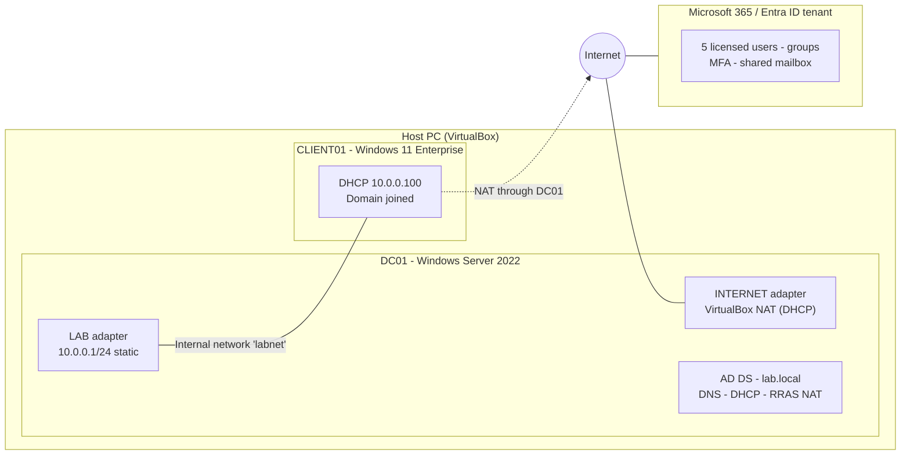

## What I built

| Component | Details |
| --- | --- |
| Domain controller | Windows Server 2022, `DC01`, forest `lab.local` with integrated DNS and a reverse lookup zone |
| Networking | Two NICs on DC01; static `10.0.0.1/24` on the isolated lab network; RRAS NAT shares internet with clients |
| DHCP | Authorized scope `10.0.0.100-200` handing out gateway, DNS and domain name; bound to the LAB interface only |
| Client | Windows 11 Enterprise `CLIENT01`, joined to the domain |
| Directory structure | OUs `_Users` (Sales, HR, IT) and `_Disabled`; security groups `GG_Sales`, `GG_HR`, `GG_IT`, `GG_Helpdesk` |
| Users | 20+ users created from CSV with a rerunnable PowerShell script ([scripts](scripts/)) |
| Help desk role | `GG_Helpdesk` delegated "reset password and force change at next logon" on `_Users`; verified it can reset passwords but is denied other changes |
| File shares | `\\DC01\Sales`, `HR`, `IT`, locked down with both share and NTFS permissions per department group |
| Group Policy | `Drive Maps` GPO with item-level targeting (S:, H:, I: by group); account lockout policy (5 attempts / 15 min) in Default Domain Policy |
| Microsoft 365 | Business Premium trial tenant: licensed users, security and Microsoft 365 groups, security defaults with Microsoft Authenticator, shared mailbox |

## Build evidence

**On-prem**

| | |
| --- | --- |
| 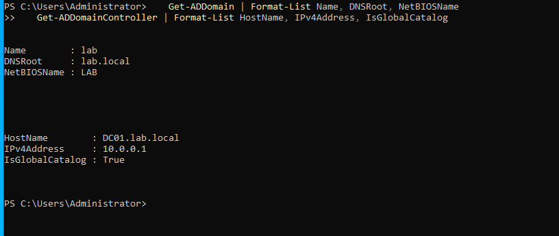 | 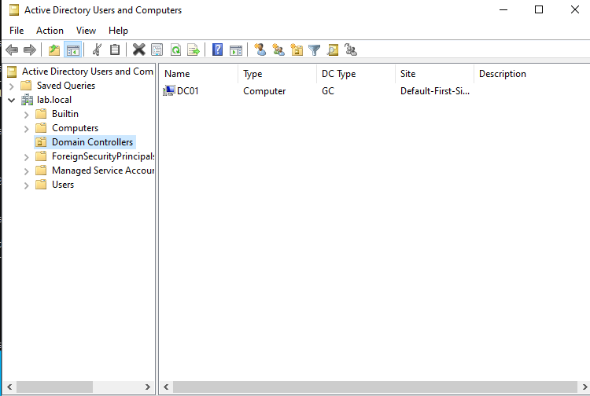 |
| Forest `lab.local`, DC01 at 10.0.0.1 | DC01 as global catalog |
| 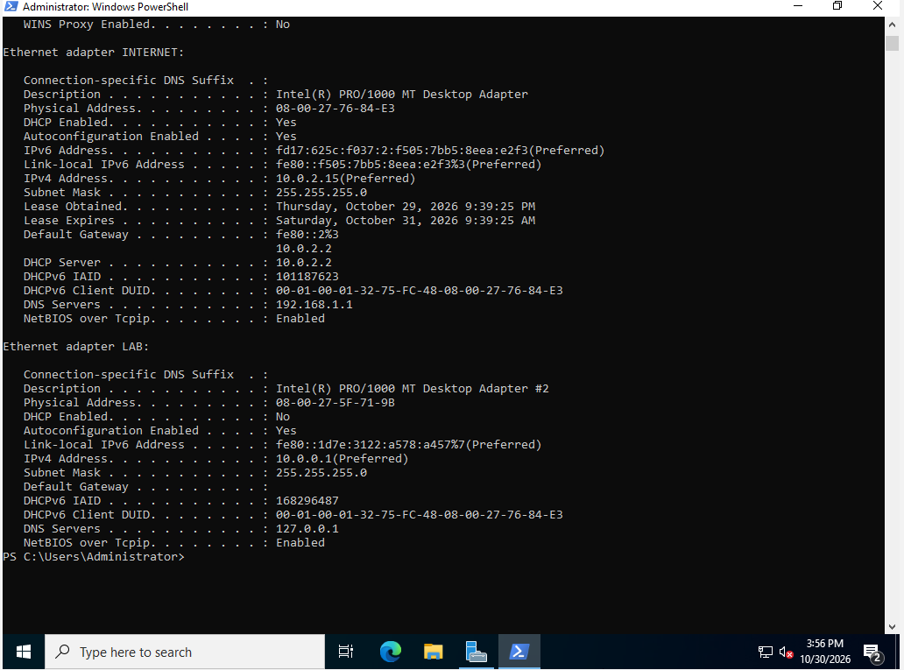 | 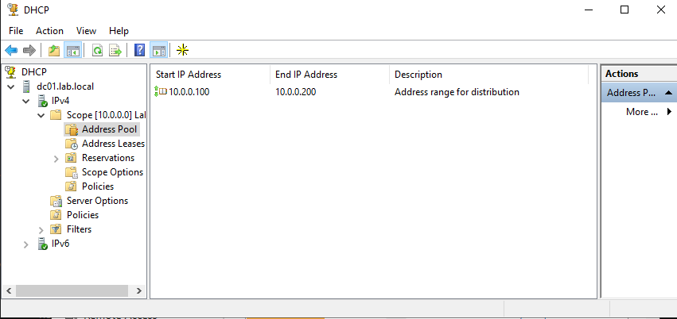 |
| Static LAB adapter 10.0.0.1/24, DNS pointing to itself | DHCP scope 10.0.0.100-200 |
| 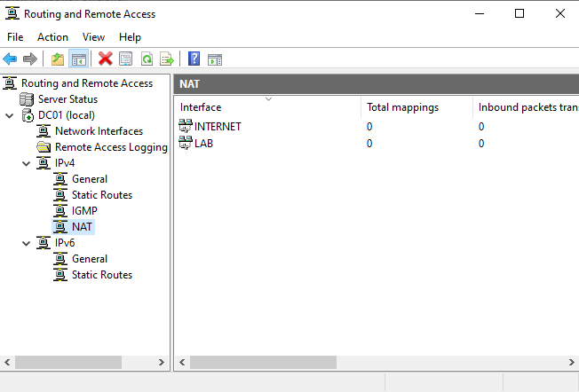 | 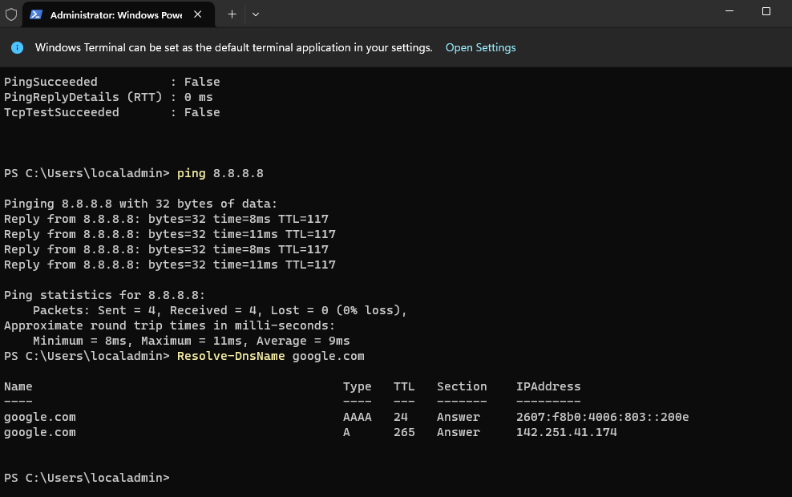 |
| RRAS NAT: INTERNET public, LAB private | Client reaching the internet through DC01 after enabling IPv4 LAN routing |
| 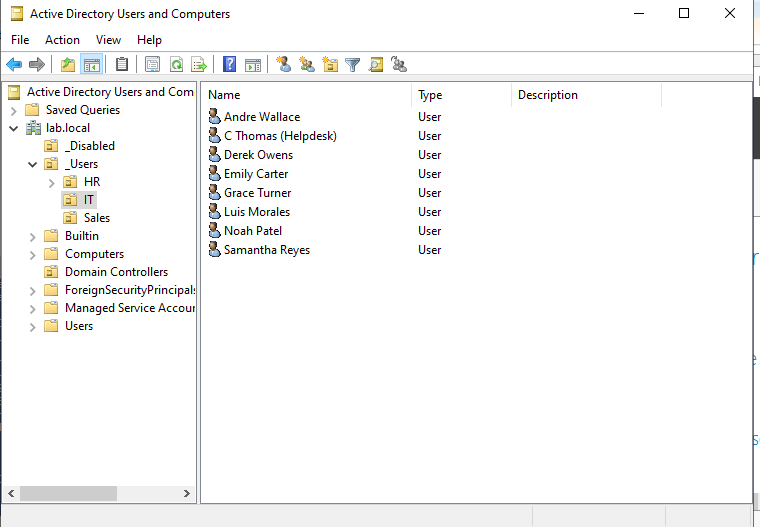 | 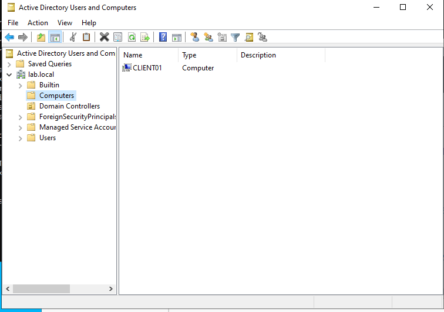 |
| Department OUs with users, including the delegated help desk account | CLIENT01 joined to the domain |
| 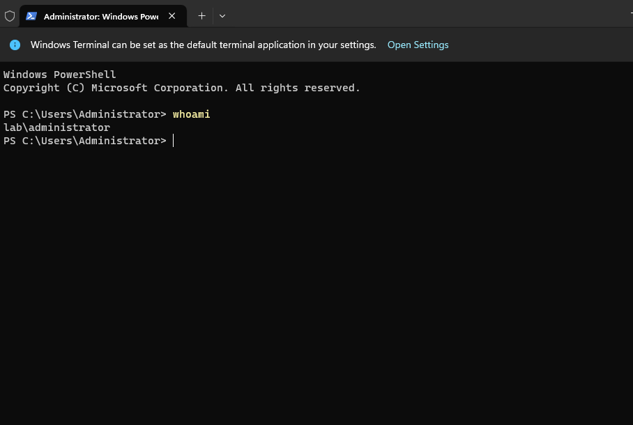 | 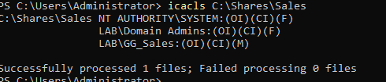 |
| Domain sign-in on the client | Sales share: only GG_Sales (Modify), Domain Admins and SYSTEM |
| 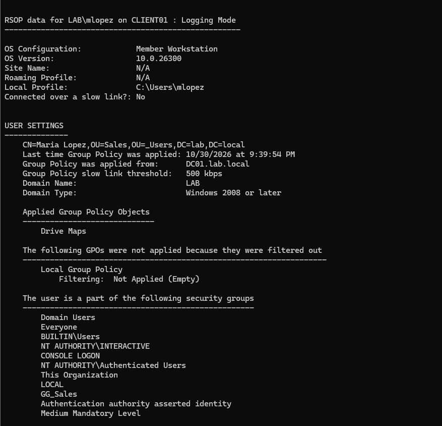 | 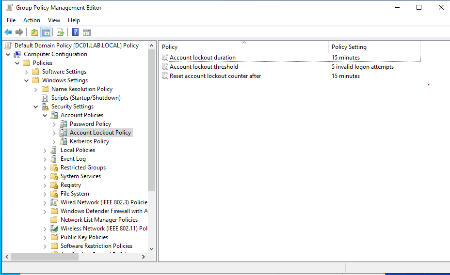 |
| Drive Maps GPO applied to a Sales user | Lockout policy: 5 attempts, 15 minutes |
| 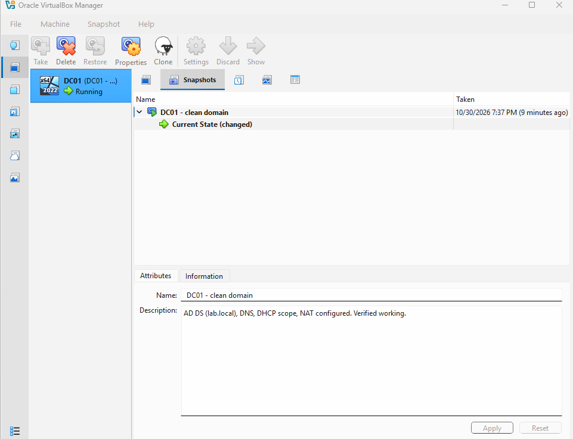 | |
| Clean snapshot before adding clients | |

**Microsoft 365**

| | |
| --- | --- |
| 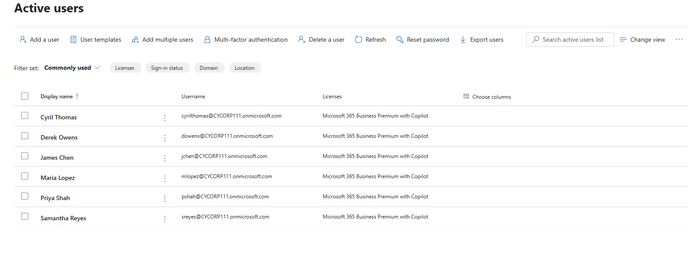 | 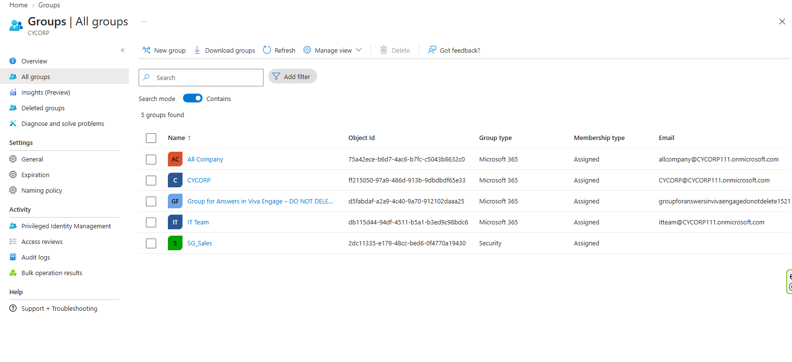 |
| Five licensed users (Business Premium) | Security group vs Microsoft 365 group |
| 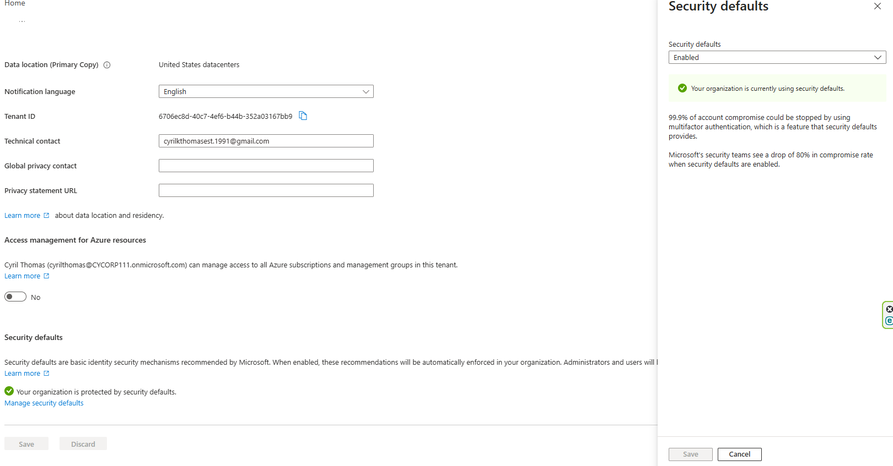 | |
| Security defaults enabled (MFA for all users) | |

## Tickets worked

Each runbook covers symptoms, first checks, cause, fix (GUI and PowerShell), verification, and when to escalate.

| # | Ticket (user's words) | Runbook |
| --- | --- | --- |
| 1 | "I'm locked out" | [01-account-lockout](runbooks/01-account-lockout.md) |
| 2 | "I forgot my password" | [02-password-reset](runbooks/02-password-reset.md) |
| 3 | "I moved to HR and can't open the HR drive" | [03-department-move](runbooks/03-department-move.md) |
| 4 | "My S: drive disappeared" | [04-missing-drive-map](runbooks/04-missing-drive-map.md) |
| 5 | "New hire starts Monday" | [05-new-hire](runbooks/05-new-hire.md) |
| 6 | "Employee left today" | [06-offboarding](runbooks/06-offboarding.md) |
| 7 | "I can't log in, it says domain not available" | [07-dns-domain-unavailable](runbooks/07-dns-domain-unavailable.md) |
| 8 | "Trust relationship between this workstation and the domain failed" | [08-trust-relationship](runbooks/08-trust-relationship.md) |
| 9 | "I got a new phone and can't get my MFA code" | [m365-01-mfa-reregister](runbooks/m365-01-mfa-reregister.md) |
| 10 | "Our team needs a shared inbox" | [m365-02-shared-mailbox](runbooks/m365-02-shared-mailbox.md) |
| 11 | "My mailbox is full" / "Outlook won't open" | [m365-03-mailbox-full-outlook](runbooks/m365-03-mailbox-full-outlook.md) |
| 12 | Cloud offboarding | [m365-04-cloud-offboarding](runbooks/m365-04-cloud-offboarding.md) |

## Problems I hit and solved along the way

The guide didn't cover these; working through them taught me more than the steps that went smoothly.

- **Forest promotion silently failed.** AD services existed but were stopped and the DNS service was missing. Diagnosed with `Get-Service`, reran `Install-ADDSForest`, verified with `Get-ADDomain`.
- **DNS returned the NAT address for the domain.** The INTERNET adapter registered `10.0.2.15` in DNS, which clients can't reach. Stopped that adapter from registering, limited DNS listening to `10.0.0.1`, removed the stale record.
- **Clients had no internet through NAT.** DC01 could reach the internet but forwarded nothing; IPv4 LAN routing was off in RRAS. Enabled it and confirmed from the client.
- **Stale drive letters after losing group membership.** Group Policy Preferences with the Update action skip the drive instead of removing it, so the letter stayed but was denied. Fix: "Remove this item when it is no longer applied."
- **Stale `gpresult` output.** Group memberships load into the Kerberos ticket at sign-in, so the user had to sign out and back in before results changed.
- **Login worked with bad DNS.** NetBIOS fallback let a user sign in on the flat lab network even with DNS pointed at 8.8.8.8, but name resolution and Group Policy failed. In a routed network the login would fail too.
- **Snapshot trick didn't break domain trust.** AD accepts the previous computer password as well as the current one. Reproduced the failure reliably by resetting the computer account from ADUC instead.

## Skills demonstrated

Active Directory (users, OUs, groups, delegation) - Group Policy (drive maps, item-level targeting, lockout policy) - DNS and DHCP administration - share vs. NTFS permissions - PowerShell automation - Windows client troubleshooting - Microsoft 365 admin center - Entra ID (MFA, security defaults, authentication methods, sessions) - Exchange Online shared mailboxes - on-prem and cloud onboarding/offboarding - technical documentation

## Repo layout

```
README.md       this file
scripts/        New-LabUsers.ps1, users.csv (fake names only)
runbooks/       one page per ticket
screenshots/    evidence, named to match the runbooks
```

All names, passwords and the tenant are fictional lab data. The temporary password in the script is for this lab only.
