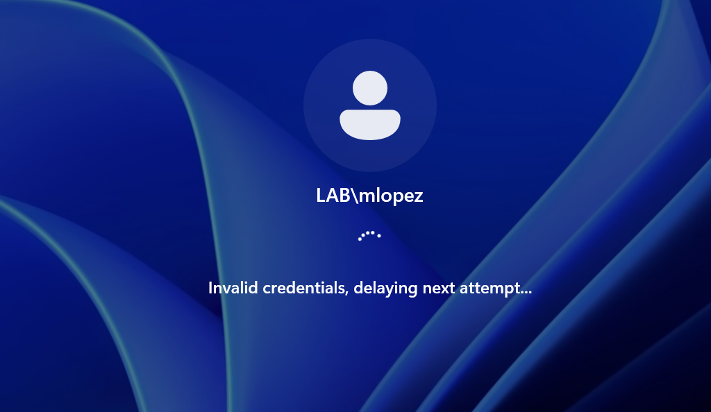
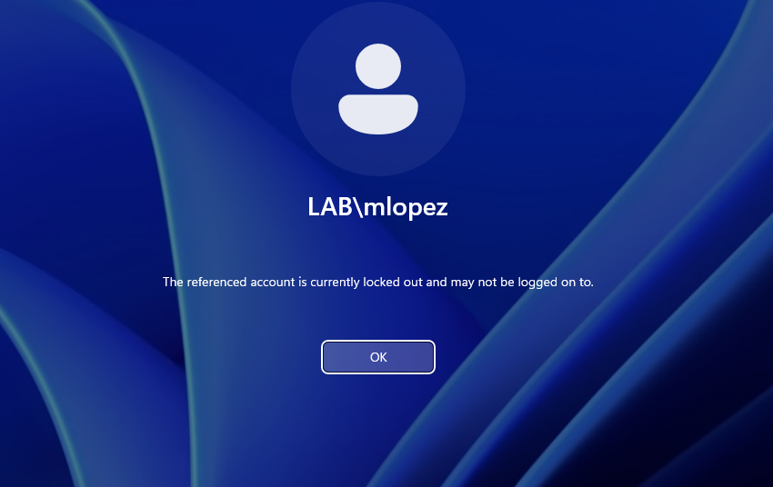
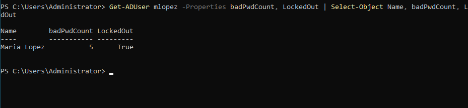
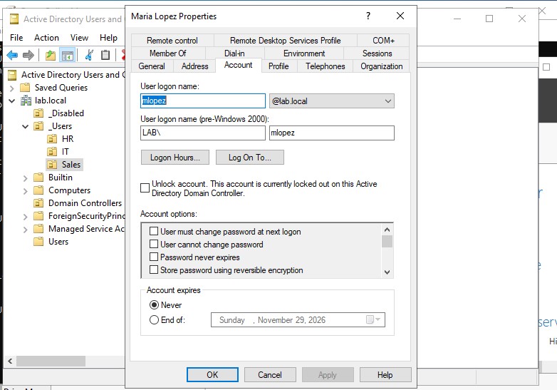
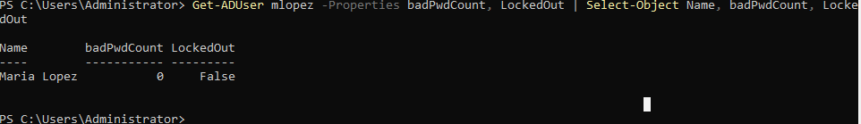
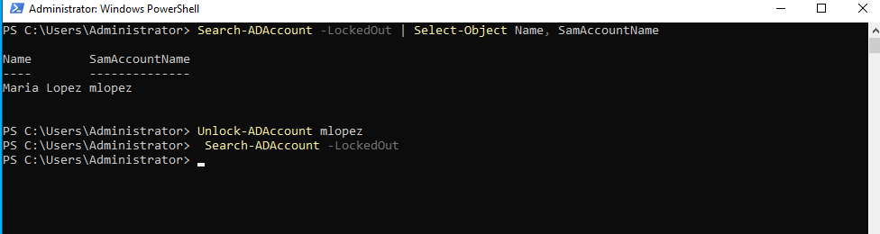

# Ticket: "I'm locked out"

**Symptoms:** User can't sign in. CLIENT01 shows "The referenced account is currently locked out and may not be logged on to."

**First checks:** Confirm the caller's identity. Check whether the account is actually locked, not just a wrong password:
`Get-ADUser mlopez -Properties badPwdCount, LockedOut`

**Cause:** 5 failed sign-in attempts triggered the domain lockout policy (threshold 5, duration 15 min, counter reset 15 min). Found `badPwdCount 5`, `LockedOut True`.

**Fix:**
- GUI: ADUC > user > Account tab > check **Unlock account** > OK.
- PowerShell: `Search-ADAccount -LockedOut` then `Unlock-ADAccount mlopez`

**Verify:** `badPwdCount 0`, `LockedOut False`; `Search-ADAccount -LockedOut` returns nothing; user signs in.

**Escalate if:** Lockouts keep recurring with no user error. Check for an old password saved on a phone or mapped drive first; if lockouts come from a device the user doesn't own, report to security as possible password guessing.

**Notes:** Windows 11 adds its own short delay after each wrong password ("Invalid credentials, delaying next attempt"), separate from the domain policy.

