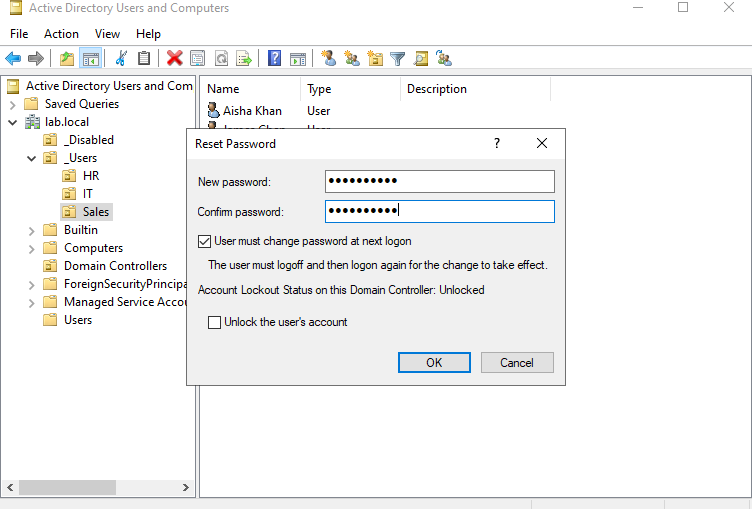
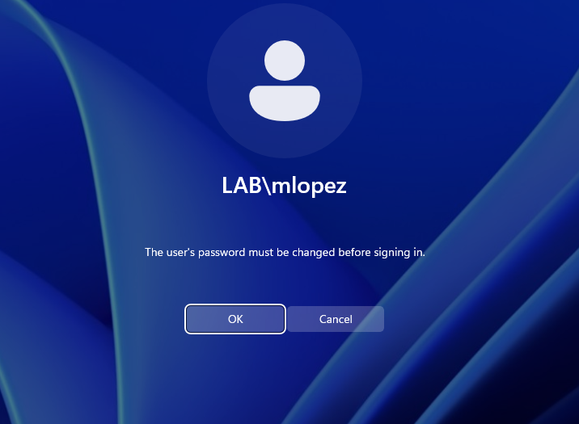
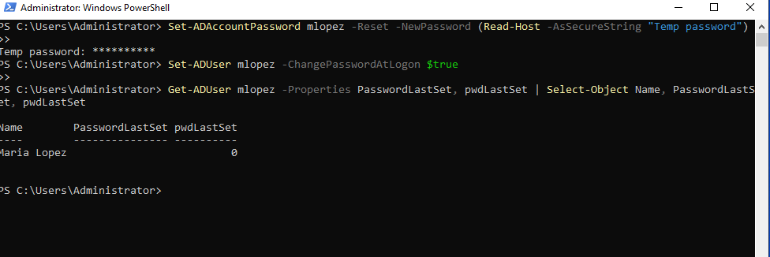
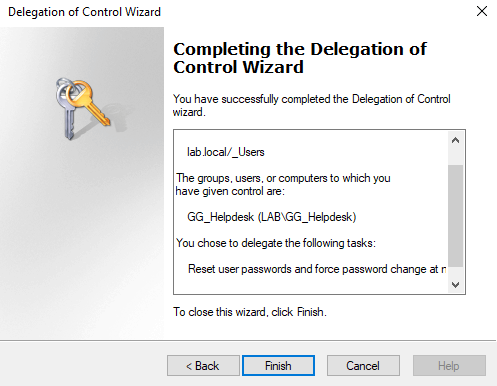
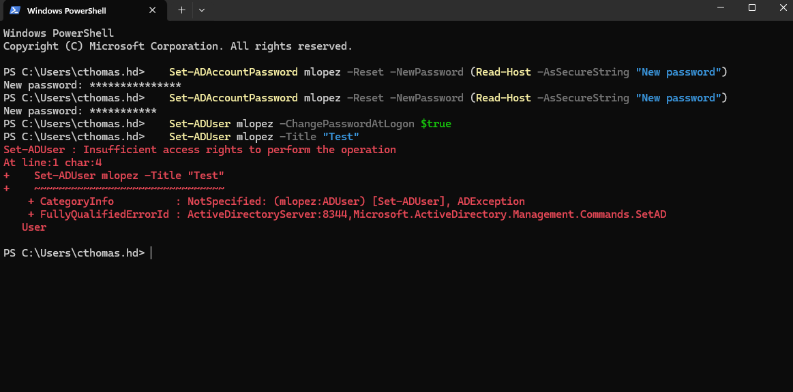

# Ticket: "I forgot my password"

**Symptoms:** User can't remember their password.

**First checks:** Verify the caller's identity before resetting (callback to the number on file, employee ID, or the company's process). Password resets are a common social engineering target.

**Cause:** Forgotten password. The Reset Password dialog showed lockout status **Unlocked**, so only a reset was needed.

**Fix:**
- GUI: ADUC > right-click user > **Reset Password** > temp password > check **User must change password at next logon** (and **Unlock the user's account** if locked).
- PowerShell:
  ```powershell
  Set-ADAccountPassword mlopez -Reset -NewPassword (Read-Host -AsSecureString "Temp password")
  Set-ADUser mlopez -ChangePasswordAtLogon $true
  ```

**Verify:** `pwdLastSet` = 0 (forced change pending); at sign-in the user sees "The user's password must be changed before signing in" and sets a new one.

**Escalate if:** Identity can't be verified, or the request is for a privileged account.

**Notes:** This reset can be done by the help desk without Domain Admin rights: `GG_Helpdesk` has delegated "Reset user passwords and force password change at next logon" on `_Users`. Tested as `cthomas.hd`: the reset succeeded and `Set-ADUser -Title` was denied with "Insufficient access rights."






