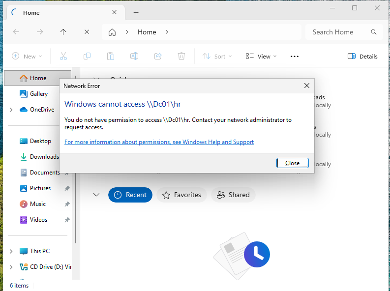
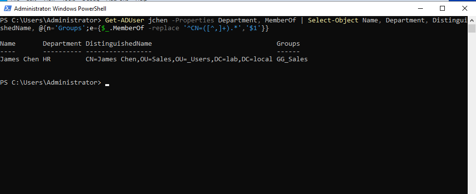
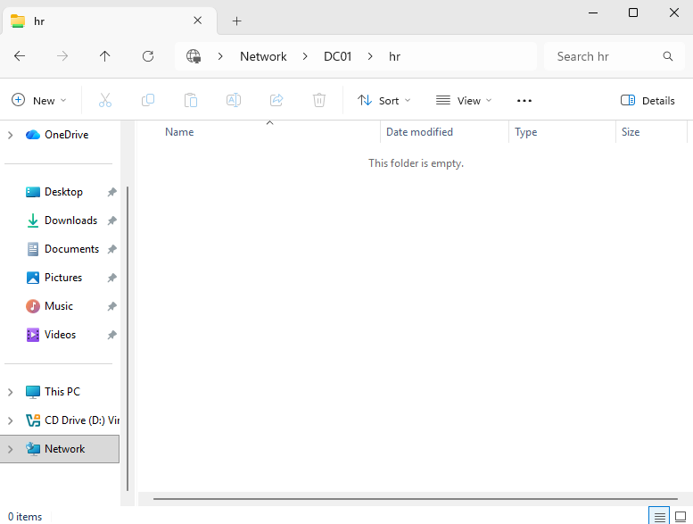
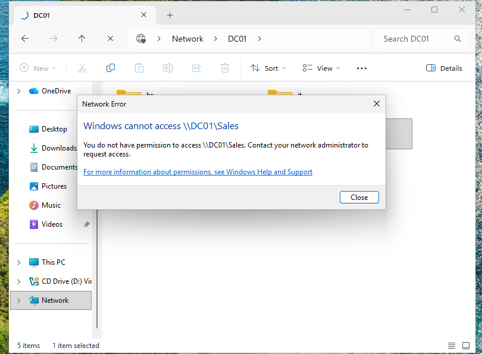
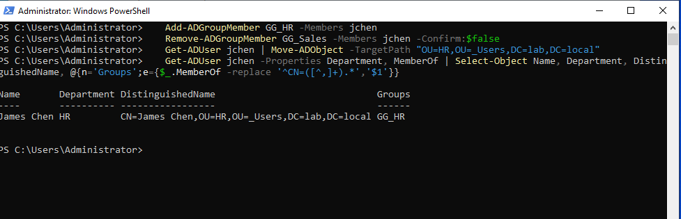

# Ticket: "I moved to HR and can't open the HR drive"

**Symptoms:** `\\DC01\HR` returns "You do not have permission to access." The user still has the Sales drive.

**First checks:** Reproduce the error, then compare the user's department, OU and groups:
`Get-ADUser jchen -Properties Department, MemberOf`

**Cause:** Department was updated to HR, but the account was still in `OU=Sales` and `GG_Sales`. The HR change never reached the user's access.

**Fix:**
- GUI: ADUC > user > Member Of > add `GG_HR`, remove `GG_Sales`; right-click > Move > `_Users\HR`.
- PowerShell:
  ```powershell
  Add-ADGroupMember GG_HR -Members jchen
  Remove-ADGroupMember GG_Sales -Members jchen -Confirm:$false
  Get-ADUser jchen | Move-ADObject -TargetPath "OU=HR,OU=_Users,DC=lab,DC=local"
  ```
- User signs out and back in so the new groups load.

**Verify:** `\\DC01\HR` opens; `\\DC01\Sales` is now denied (old access removed, not just new access added). AD shows `OU=HR` and `GG_HR` only.

**Escalate if:** There's no approval. Access changes need sign-off from HR or the new manager, not just the user's request.






