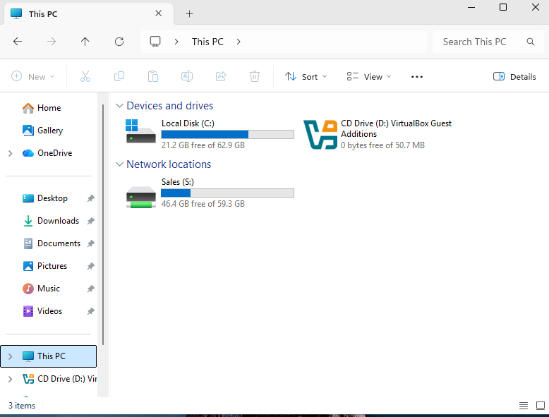
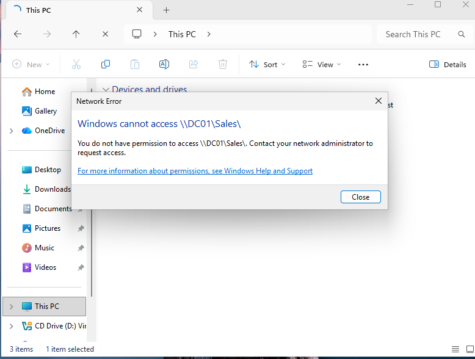
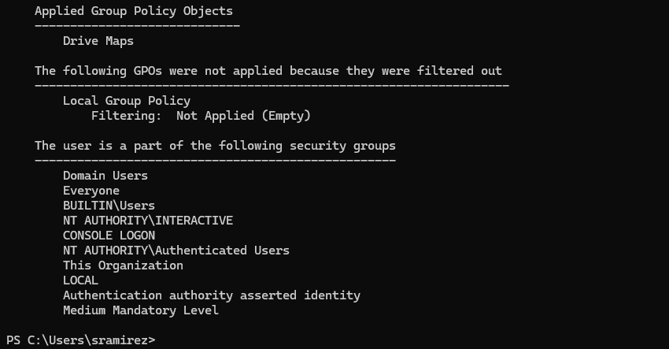
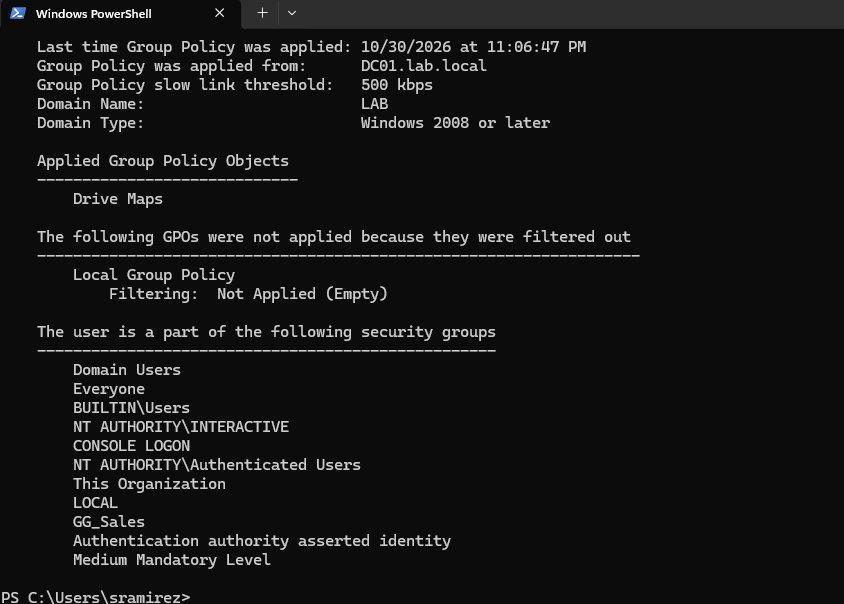
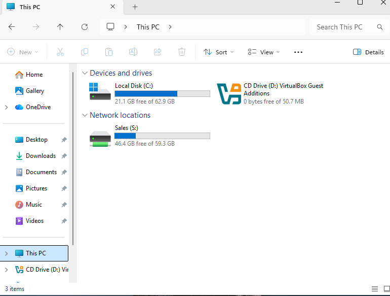
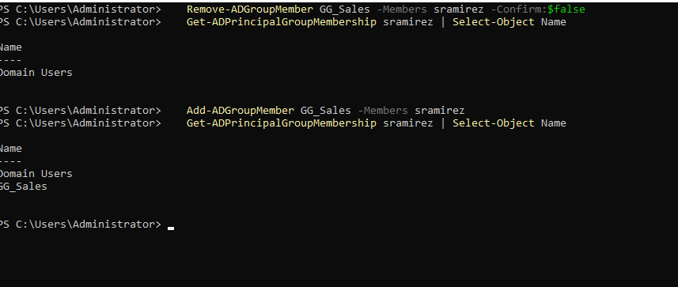

# Ticket: "My S: drive disappeared"

**Symptoms:** The S: drive no longer works. In practice it stayed listed with no capacity bar and returned "You do not have permission" when opened.

**First checks:** As the user, run `gpresult /r`. Check that **Drive Maps** is applied and whether **GG_Sales** is in the user's security groups.

**Cause:** User was removed from `GG_Sales`. The Drive Maps GPO still applied, but item-level targeting skipped the S: drive. Because the drive map uses Update with Reconnect, the old letter stayed behind.

**Fix:**
- GUI: ADUC > user > Member Of > add `GG_Sales`.
- PowerShell: `Get-ADPrincipalGroupMembership sramirez` to confirm, then `Add-ADGroupMember GG_Sales -Members sramirez`.
- User signs out and back in.

**Verify:** `gpresult /r` lists `GG_Sales`; S: shows capacity and opens.

**Escalate if:** The removal was intentional. Check for a recent access change before adding the user back.

**Notes:**
- The first `gpresult` was stale: it showed policy from the logon before the change. Group memberships load into the Kerberos ticket at sign-in, so the user has to sign in again.
- Improvement: set "Remove this item when it is no longer applied" on each drive map so losing the group removes the drive instead of leaving a dead letter.

