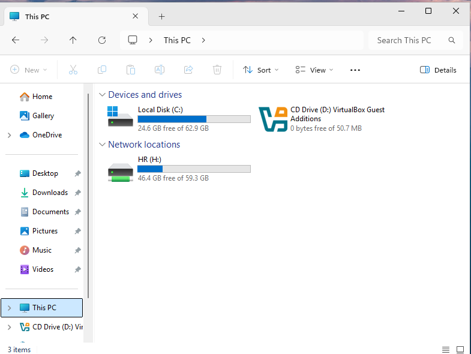
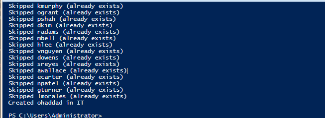

# Ticket: "New hire starts Monday"

**Symptoms:** Onboarding request for a new employee.

**First checks:** Confirm department, manager approval and start date from the HR or manager request.

**Cause:** n/a (provisioning request).

**Fix:**
- GUI: ADUC > department OU > New > User; temp password with "must change at next logon"; set Department; add the department group (`GG_HR`).
- PowerShell: add a row to `users.csv` and rerun [New-LabUsers.ps1](../scripts/New-LabUsers.ps1). The script skips existing accounts, so reruns are safe.

**Verify:** User signs in, sets a new password, and sees only their department drive (H: for HR). Script rerun showed 20 "Skipped" and one "Created ohaddad in IT."

**Escalate if:** No approved onboarding request, or the hire needs access beyond their department.

**Notes:** First sign-in failed with `badPwdCount 0`, meaning the attempt never reached AD: the username was typed without the domain, so Windows tried a local account. `LAB\nalvarez` worked.

## Screenshots

   
  <em>New HR hire sees only the HR drive</em>

   
  <em>Rerunnable script: 20 skipped, 1 created</em>

