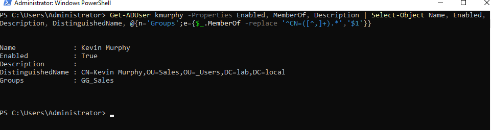
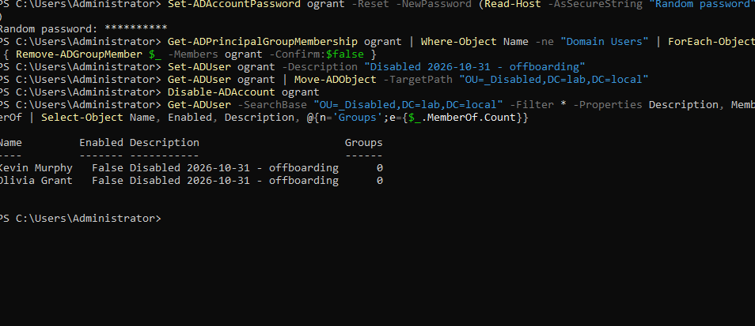

# Ticket: "Employee left today"

**Symptoms:** Offboarding request for a departing employee.

**First checks:** Confirm the request came from HR or the manager, and the effective time. Check the account's current state, groups and OU.

**Cause:** n/a (deprovisioning request). Before: enabled, in `OU=Sales`, member of `GG_Sales`.

**Fix (disable first, so the account can't be used mid-process):**
- GUI: ADUC > Disable Account > Reset Password (random) > Member Of: remove groups > Description: date and reason > Move to `_Disabled`.
- PowerShell:
  ```powershell
  Disable-ADAccount ogrant
  Set-ADAccountPassword ogrant -Reset -NewPassword (Read-Host -AsSecureString "Random password")
  Get-ADPrincipalGroupMembership ogrant | Where-Object Name -ne "Domain Users" |
    ForEach-Object { Remove-ADGroupMember $_ -Members ogrant -Confirm:$false }
  Set-ADUser ogrant -Description "Disabled 2026-10-31 - offboarding"
  Get-ADUser ogrant | Move-ADObject -TargetPath "OU=_Disabled,DC=lab,DC=local"
  ```

**Verify:** Both leavers in `_Disabled` with `Enabled False`, the dated description and 0 groups. Sign-in attempt shows the account is disabled.

**Escalate if:** Mailbox, file retention or device recovery is needed; those go to other teams.

**Notes:** `_Disabled` sits outside `_Users`, so the Drive Maps GPO and help desk delegation no longer apply to the account. Domain Users stays because it is the primary group.

## Screenshots

<p align="center">
  <br>
  <em>Before: enabled, Sales OU, GG_Sales</em>
</p>
<p align="center">
  <br>
  <em>After: both leavers disabled, dated, 0 groups, in _Disabled</em>
</p>
