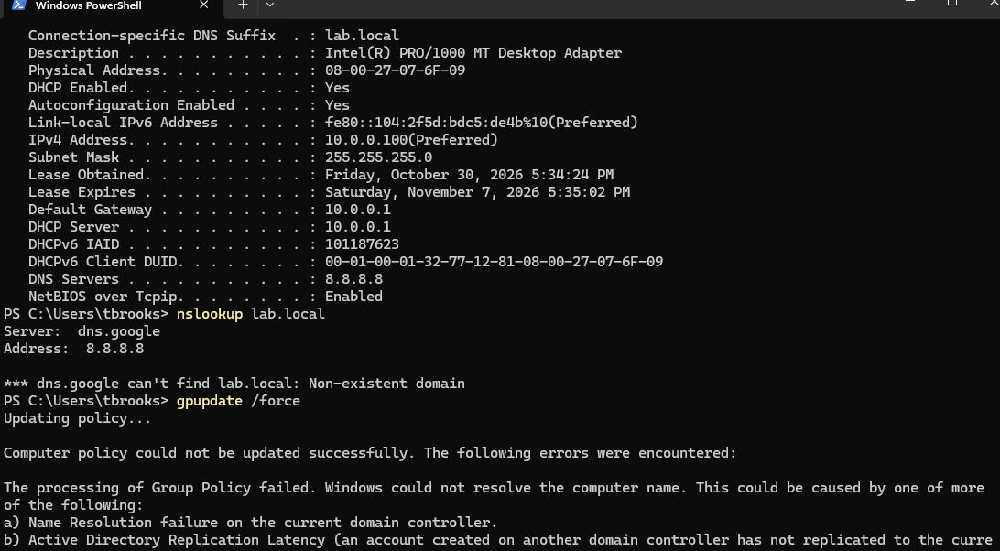
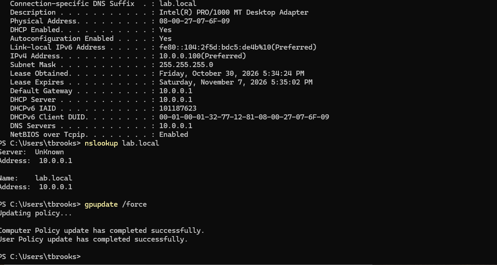
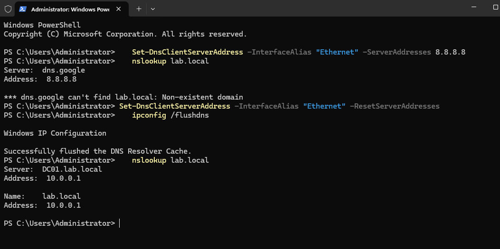

# Ticket: "I can't log in, it says domain not available"

**Symptoms:** Domain sign-in problems; domain resources and policy not working.

**First checks:** Sign in with a local admin or the user's session, then:
`ipconfig /all`, `nslookup lab.local`, `gpupdate /force`

**Cause:** Client DNS was set to `8.8.8.8`. Public DNS can't resolve the private domain: `nslookup` returned "Non-existent domain" and Group Policy failed for computer and user ("could not resolve").

**Fix:**
- GUI: Settings > Network & internet > Ethernet > DNS server assignment > Edit > **Automatic (DHCP)** (admin credentials required).
- PowerShell (admin):
  ```powershell
  Set-DnsClientServerAddress -InterfaceAlias "Ethernet" -ResetServerAddresses
  ipconfig /flushdns
  ```

**Verify:** DNS server `10.0.0.1`; `nslookup lab.local` returns `10.0.0.1`; both policies update successfully.

**Escalate if:** Many users report it at once. That points to a network or DNS server outage, not one machine.

**Notes:**
- The login actually still worked: NetBIOS fallback found DC01 on the flat lab subnet. In a routed enterprise network it would fail, and users with cached credentials could also hide the problem.
- Added a reverse lookup zone (`10.0.0.0/24`) on DC01 so `nslookup` shows `DC01.lab.local` instead of "UnKnown."

## Screenshots

<p align="center">
  <br>
  <em>DNS set to 8.8.8.8: lab.local not found, Group Policy failing</em>
</p>
<p align="center">
  <br>
  <em>DNS reset to 10.0.0.1: name resolution and Group Policy working</em>
</p>
<p align="center">
  <br>
  <em>PowerShell break and fix</em>
</p>
