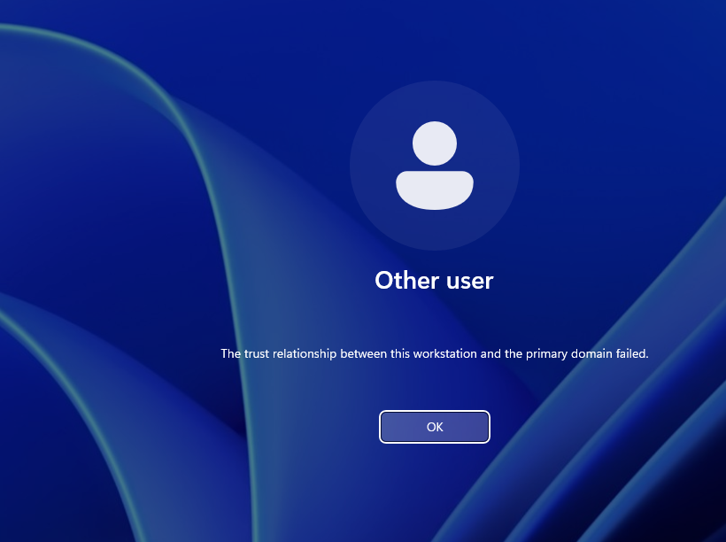
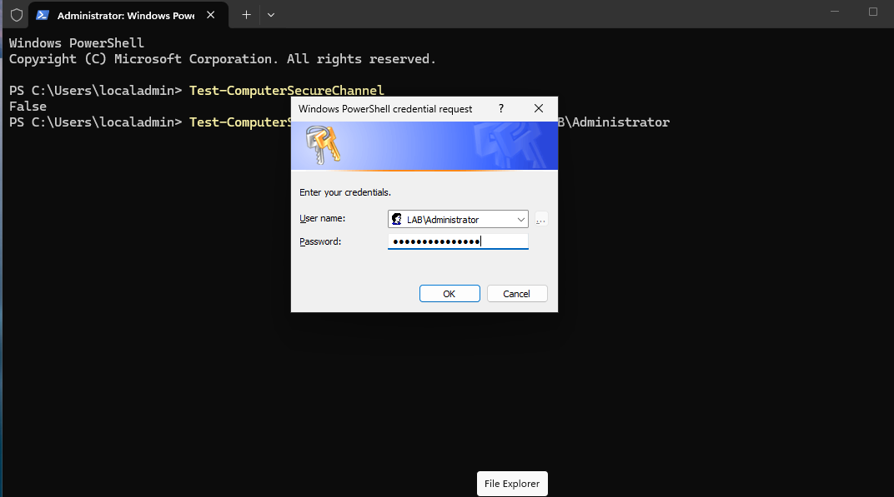

# Ticket: "The trust relationship between this workstation and the primary domain failed"

**Symptoms:** Domain sign-in on CLIENT01 fails with the trust relationship error.

**First checks:** Sign in as the local admin (`.\localadmin`) and run `Test-ComputerSecureChannel`. It returned **False**.

**Cause:** CLIENT01's machine account password no longer matched its computer account in AD. Reproduced by resetting the computer account in ADUC (Computers > CLIENT01 > Reset Account) and restarting the client.

**Fix:**
- PowerShell (admin, as local admin):
  ```powershell
  Test-ComputerSecureChannel -Repair -Credential LAB\Administrator
  ```
- GUI alternative: remove the PC from the domain and rejoin.

**Verify:** Repair returned **True**; after a restart a domain user signed in.

**Escalate if:** Many machines break at once or it recurs after reimaging; find the cause (imaging, snapshot restores, account resets).

**Notes:**
- The common snapshot method (reset the machine password, then restore an older snapshot) didn't break trust here. AD accepts both the current and the previous machine password, so a single reset still leaves the old one valid.
- Test with a user who has never signed in on that PC; cached credentials can let previous users in and hide the error.



