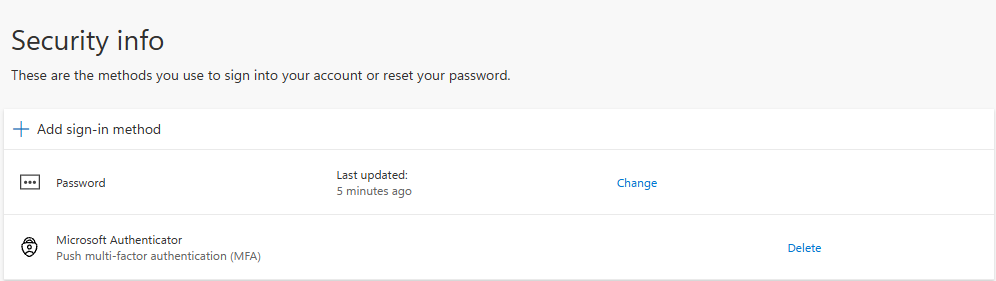
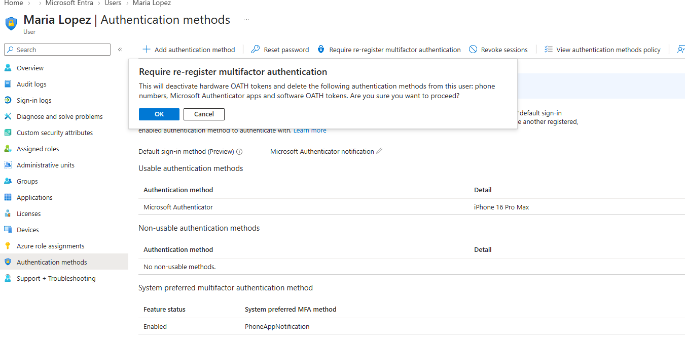
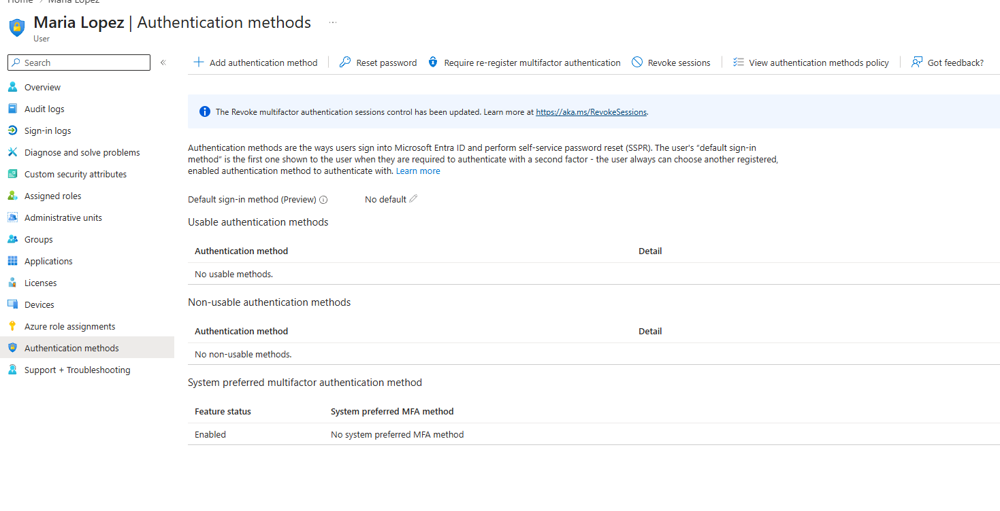
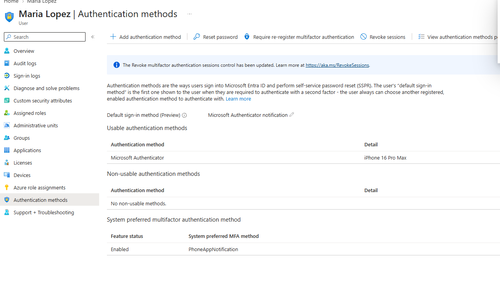

# Ticket: "I got a new phone and can't get my MFA code"

**Symptoms:** User can't approve MFA prompts; the Authenticator app was on the old phone.

**First checks:** Verify the caller's identity first; MFA resets are a top social engineering target. Then Entra > Users > user > **Authentication methods** shows Microsoft Authenticator registered to the old device.

**Cause:** The registered MFA method lives on a device the user no longer has.

**Fix:**
- Entra > Users > user > Authentication methods > **Require re-register multifactor authentication** > OK. This deletes registered phone numbers and Authenticator apps.
- User re-registers Authenticator on the new phone (at sign-in, or at `aka.ms/mfasetup`).

**Verify:** Authentication methods shows "No usable methods" after the reset, then Microsoft Authenticator on the new phone after re-registration.

**Escalate if:** Identity can't be verified, or the account is privileged.

**Notes:** With security defaults, the user wasn't forced to re-register at the very next sign-in, so they re-registered at `aka.ms/mfasetup`. Production tenants (Business Premium includes Entra ID P1) would use Conditional Access to require registration immediately.

