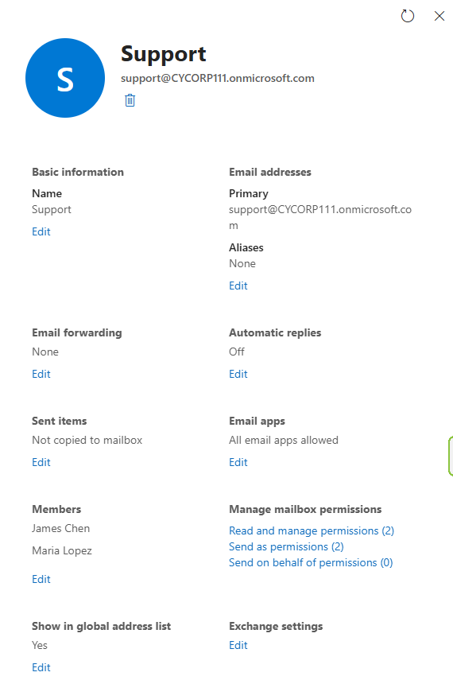
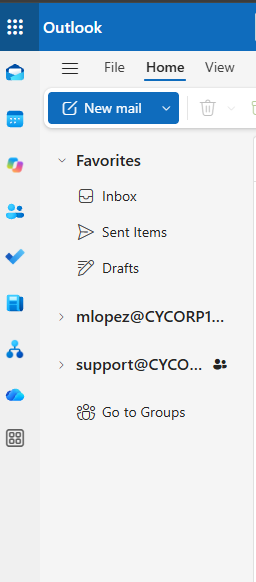

# Ticket: "Our team needs a shared inbox"

**Symptoms:** Team request for a shared support@ address.

**First checks:** Confirm who needs access and whether they need to send as the address.

**Cause:** n/a (provisioning request).

**Fix:**
- Admin center > Teams & groups > **Shared mailboxes** > Add a shared mailbox (`support@`) > add members.
- Adding members grants **Read and manage** (Full Access) and **Send as**.

**Verify:** Mailbox panel shows the members and permissions; it appears in the members' Outlook on the web. If it hasn't appeared yet, right-click the account in the folder list > **Add shared folder or mailbox** > full address.

**Escalate if:** The mailbox needs more than the free shared mailbox storage, or an archive.

**Notes:**
- Shared mailboxes don't need a license.
- Send As shows mail from support@; Send on Behalf shows "user on behalf of Support."
- By default, sent items land only in the sender's own Sent Items. Turning on sent-item copying keeps replies visible to the whole team.

