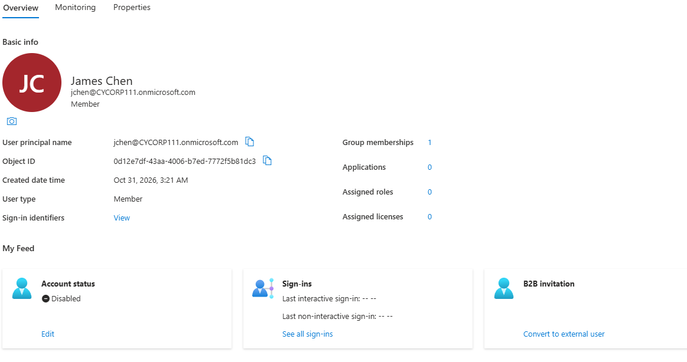
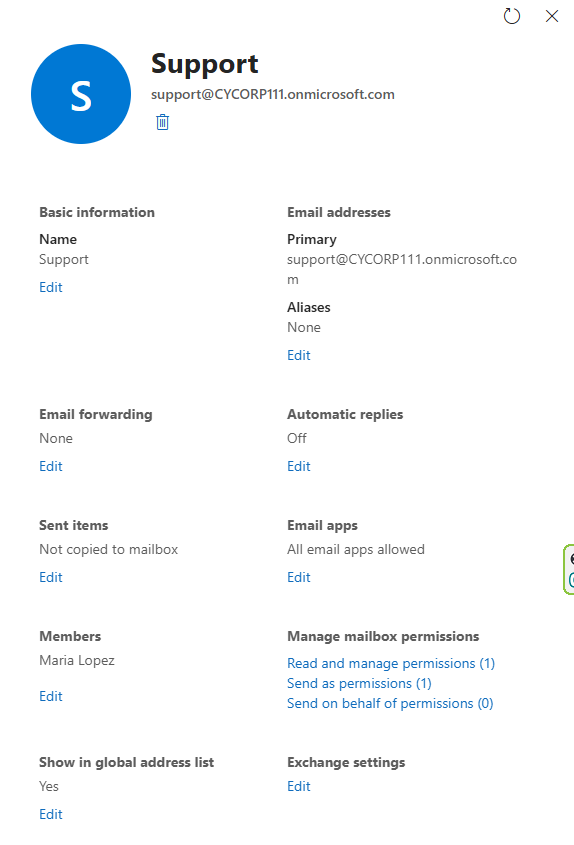
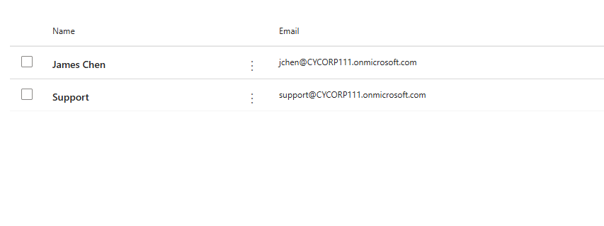

# Ticket: Cloud offboarding (employee left)

**Symptoms:** Offboarding request for a Microsoft 365 user; the manager needs to keep access to their mail.

**First checks:** Confirm the request with HR or the manager and who should receive mailbox access.

**Fix, in this order:**
1. **Block sign-in** (admin center > user > Block sign-in).
2. **Reset password** (random, not shared).
3. **Revoke sessions** (Entra > user > Revoke sessions). Blocking sign-in doesn't immediately end sessions that are already open.
4. **Convert mailbox to shared** (user > Mail tab > Convert to shared mailbox), then add the manager as a member.
5. **Remove from groups** and shared mailboxes.
6. **Remove the license, last.**

**Verify:** Entra shows Account status **Disabled** and Assigned licenses **0**; the user appears under Shared mailboxes with the manager as member; shared mailbox permissions re-checked after a refresh.

**Escalate if:** Legal hold or retention is required, or devices need recovery.

**Notes:**
- Order matters: removing the license before converting puts the mailbox on a path to deletion. Converted mailboxes don't need a license.
- Check every permission type (Full Access, Send As, Send on Behalf) after removing someone from a shared mailbox; the admin view can lag until refreshed.

## Screenshots

   
  <em>Offboarded: account disabled, no licenses</em>

   
  <em>Shared mailbox permissions after removing the leaver</em>

   
  <em>Mailbox converted to shared for the manager</em>

